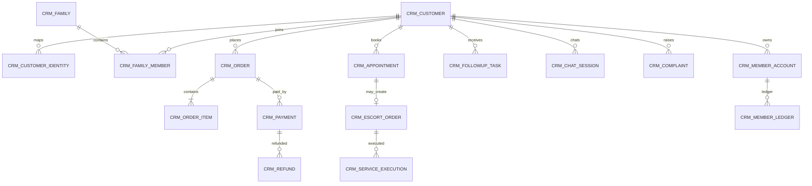

# 数据库设计说明

## 1. 数据库策略
- CRM主库：PostgreSQL 16+。
- HIS源库：Microsoft SQL Server，默认只读访问。
- 不在HIS数据库创建CRM业务表，不修改HIS临床数据。
- PostgreSQL schema建议：`public`（V1.0先统一schema，后续可按领域拆分）。
- 主键统一UUID；对外展示可另设业务编号。
- 金额使用 `numeric(18,2)`，禁止使用浮点数。
- 时间统一存储 `timestamptz`，展示时按医院时区配置。
- 所有核心业务表包含 `created_at`、`updated_at`；关键状态变更保留事件或审计记录。

## 2. 领域实体关系

## 3. 核心表清单

### 客户与家庭
- `crm_customer`：个人客户主档。
- `crm_customer_identity`：HIS患者ID、证件、手机号等身份映射。
- `crm_customer_tag`、`crm_tag`：客户标签。
- `crm_family`：家庭账户。
- `crm_family_member`：家庭成员和关系。
- `crm_customer_consent`：授权、告知、撤回记录。
- `crm_customer_merge_request`：重复客户合并申请和审核。
- `crm_his_sync_log`：HIS查询/同步日志。
- `crm_patient_snapshot`：经授权缓存的患者摘要。

### 运营与预约
- `crm_lead`：线索。
- `crm_invitation`：邀约。
- `crm_appointment`：预约。
- `crm_activity`、`crm_activity_participant`：活动和参与人。

### 员工与服务
- `crm_staff`：陪诊师、医护、客服等人员主档。
- `crm_staff_qualification`：资质。
- `crm_service_catalog`：陪诊/上门服务目录。
- `crm_staff_schedule`：排班。
- `crm_service_order`：服务订单。
- `crm_service_assignment`：派单/接单。
- `crm_service_execution`：签到、开始、完成和执行记录。
- `crm_service_evaluation`：评价。
- `crm_service_exception`：异常上报。

### 随访与客服
- `crm_followup_category`、`crm_followup_template`、`crm_followup_plan`、`crm_followup_task`、`crm_followup_record`。
- `crm_chat_session`、`crm_chat_message`、`crm_chat_handoff`。
- `crm_knowledge_base`、`crm_knowledge_document`、`crm_knowledge_chunk`。
- `crm_call_record`、`crm_call_recording`。
- `crm_message_template`、`crm_message_outbox`。

### 商保、投诉、会员、交易
- `crm_insurance_company`、`crm_insurance_policy`、`crm_insurance_case`、`crm_insurance_material`、`crm_insurance_event`。
- `crm_complaint`、`crm_complaint_action`。
- `crm_member_account`、`crm_member_package`、`crm_member_entitlement`、`crm_member_ledger`。
- `crm_order`、`crm_order_item`、`crm_payment`、`crm_refund`、`crm_reconciliation`、`crm_invoice_record`。

### 系统管理
- `sys_user`、`sys_role`、`sys_permission`、`sys_user_role`、`sys_role_permission`、`sys_org`、`sys_audit_log`、`sys_dict`、`sys_config`、`sys_api_client`。

## 4. 关键字段约定

### crm_customer
- `id UUID PK`
- `customer_no VARCHAR(32) UNIQUE`
- `name VARCHAR(100)`
- `gender VARCHAR(16)`：unknown/male/female/other
- `birth_date DATE`
- `phone_encrypted TEXT`、`phone_hash VARCHAR(128)`、`phone_masked VARCHAR(32)`
- `id_no_encrypted TEXT`、`id_no_hash VARCHAR(128)`、`id_no_masked VARCHAR(32)`
- `source_code VARCHAR(32)`
- `status VARCHAR(20)`：active/merged/disabled
- `merged_into UUID NULL`
- `created_at`、`updated_at`

身份映射不得以姓名作为唯一键。证件号和手机号均可能变更、重复或被家庭成员共用；身份匹配策略需医院确认。

### crm_customer_identity
- `customer_id UUID FK`
- `source_system VARCHAR(50)`：HIS/EMR/CRM/OTHER
- `identity_type VARCHAR(32)`：his_patient_id/mrn/visit_no/mobile/id_no
- `identity_value_encrypted TEXT`
- `identity_value_hash VARCHAR(128)`
- `is_verified BOOLEAN`
- `valid_from`、`valid_to`
- 对 `source_system + identity_type + identity_value_hash` 建索引；是否唯一由医院身份规则决定。

### crm_family_member
- `family_id UUID FK`
- `customer_id UUID FK`
- `relationship_code VARCHAR(32)`
- `is_admin BOOLEAN`
- `authorization_scope JSONB`
- `valid_from`、`valid_to`
- 不以家庭关系自动授予医疗数据访问权限。

### crm_order
- `order_no VARCHAR(40) UNIQUE`
- `customer_id UUID FK`
- `order_type VARCHAR(32)`：escort/home_service/package/recharge/other
- `status VARCHAR(24)`
- `currency CHAR(3)` 默认 CNY
- `total_amount NUMERIC(18,2)`
- `discount_amount NUMERIC(18,2)`
- `payable_amount NUMERIC(18,2)`
- `paid_amount NUMERIC(18,2)`
- `refunded_amount NUMERIC(18,2)`
- `idempotency_key VARCHAR(100)`
- `created_at`、`updated_at`

### crm_payment
记录每次支付尝试及渠道流水；支付回调以渠道交易号和幂等键去重。不得只在订单上保存支付状态而丢失交易明细。

### crm_member_ledger
不可变账本，记录充值、消费、退款、调整、过期等事件。调整必须有原因、操作人和审批记录。

## 5. 状态机建议

### 服务订单
`draft -> pending_review -> pending_assignment -> assigned -> accepted -> in_service -> service_completed -> pending_payment -> paid -> closed`
异常分支：`cancelled`、`rejected`、`exception_pending`、`refunding`、`refunded`。
不同服务类型允许不同路径，通过状态机配置控制；禁止前端直接任意修改状态。

### 支付
`created -> processing -> succeeded | failed | expired`
退款：`requested -> processing -> succeeded | failed | rejected`。

### 投诉
`submitted -> accepted -> assigned -> investigating -> rectifying -> awaiting_feedback -> reviewing -> closed`
超时或重大投诉可进入 `escalated`。

### 商保
`registered -> eligibility_check -> quotation -> pre_authorization -> service_done -> claim_submitted -> supplement_required | under_review -> approved | partially_approved | rejected -> reconciled`。

## 6. 索引和性能
- 客户：`customer_no`、手机号hash、证件hash、HIS映射。
- 订单：客户ID+创建时间、订单状态+创建时间、订单号。
- 排班：员工ID+开始/结束时间；必要时使用PostgreSQL排斥约束防止重叠。
- 随访：任务状态+计划时间、客户ID+创建时间。
- 会话：客户ID+更新时间、队列状态+创建时间。
- 审计：操作人+时间、对象类型+对象ID。
- 对大表按时间分区需在真实数据量和保留政策确定后实施，不提前过度设计。

## 7. 数据保留和删除
按医院制度、法律法规、合同和业务必要性确定保留期限。支持逻辑停用、授权撤回、脱敏、到期清理和法律保全。财务流水、审计记录不得因客户档案停用而级联删除。
